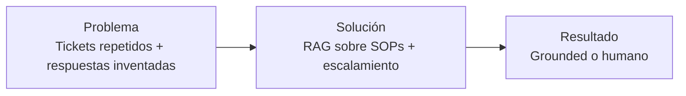

<div align="center">

# support-copilot-lab

**Copiloto de soporte con evidencia** · Angel Salazar

<br/>


</div>

---

### `$ cat diagrama.md`



---

### `$ cat problema.md`

Soporte responde lo mismo mil veces.  
Una respuesta inventada es peor que escalar.  
Este lab responde desde SOPs locales y escala si no hay evidencia.

---

```bash
pip install -e .
pytest
python -m support_copilot ask "¿Cuál es el límite comercial?"
python -m support_copilot serve
```

UI Bootstrap: http://127.0.0.1:8012

---

Hecho en Lima · Angel Salazar · CIP 404730
