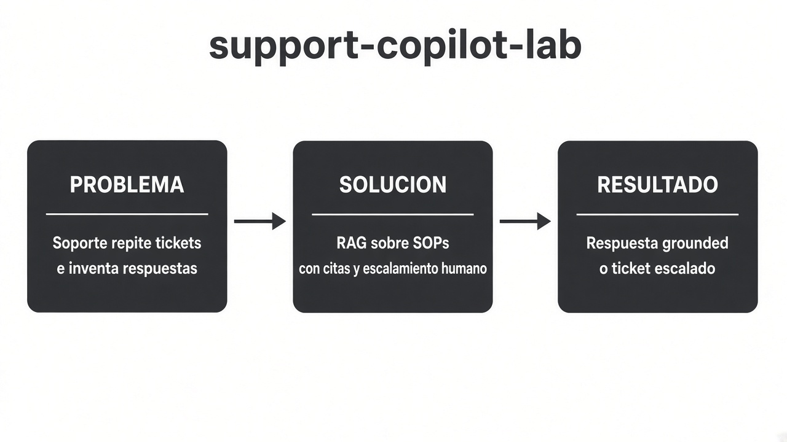
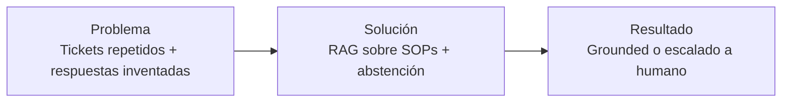

<div align="center">

# support-copilot-lab

**Copiloto de soporte con evidencia** · Angel Salazar Lima · CIP 404730

<br/>


</div>

---

## Problema

Soporte responde las mismas preguntas muchas veces. Una respuesta inventada es peor que escalar. Este lab responde solo desde SOPs locales y, si no hay evidencia suficiente, se abstiene y escala a un humano.



## Qué incluye (Nivel 3)

| Pieza | Ubicación |
|-------|-----------|
| Agente RAG con abstain/escalate | `src/support_copilot/rag.py` |
| Capa opcional con prompt-firewall | `src/support_copilot/guard.py` |
| KPIs y registro de auditoría | `metrics.py`, `audit.py` |
| Experimento reproducible | `samples/asks.jsonl`, `python -m support_copilot experiment` |
| UI de operaciones (FastAPI) | `templates/index.html`, `static/app.css` |
| Docker / Compose | `Dockerfile`, `docker-compose.yml` |
| CI | `.github/workflows/ci.yml` |
| Documentación | `docs/architecture.md`, `docs/EXPERIMENT.md`, `docs/CONCLUSIONS.md` |

## Inicio rápido

```bash
pip install -e ".[dev]"
pytest
python -m support_copilot ask "¿Cuál es el límite comercial?"
python -m support_copilot experiment
python -m support_copilot serve
```

UI: http://127.0.0.1:8012

La UI muestra tres KPIs (resoluciones con evidencia, tasa de escalamiento, confianza promedio), la sugerencia de la última consulta y el historial reciente.

## Docker

```bash
docker compose up --build
```

Sirve en http://localhost:8012. El historial se guarda en el volumen `audit-data`. Salud: `GET /health`.

Sin Compose:

```bash
docker build -t support-copilot-lab .
docker run --rm -p 8012:8012 support-copilot-lab
```

## Endpoints

| Método | Ruta | Descripción |
|--------|------|-------------|
| GET | `/` | Consola de operaciones |
| POST | `/ask` | Formulario `question`; devuelve la UI con la sugerencia |
| POST | `/clear` | Limpia el historial |
| GET | `/api/stats` | KPIs en JSON |
| GET | `/health` | Estado y número de SOPs cargados |

## Configuración

| Variable | Defecto | Efecto |
|----------|---------|--------|
| `SUPPORT_COPILOT_DATA` | `./data` | Directorio de `audit.json` |
| `SUPPORT_COPILOT_FIREWALL` | `0` | Con `1`, filtra con `prompt-firewall` si está instalado; si no, sigue sin filtro |

## Resultados del experimento

14 consultas locales contra 3 SOPs ([detalle](docs/EXPERIMENT.md)):

| Grupo | Acierto |
|-------|---------|
| Con evidencia (grounded) | 6 / 8 |
| Sin evidencia (escalate) | 6 / 6 |

Dos fallos documentados: un falso escalamiento por falta de lematización y una frase equivocada dentro del SOP correcto. Ver [CONCLUSIONS.md](docs/CONCLUSIONS.md).

## Limitaciones

- Recuperación léxica TF-IDF; no entiende sinónimos ni variantes morfológicas.
- Cita un solo documento y extrae una sola frase.
- Corpus de 3 SOPs y 14 consultas: no permite afirmar generalización.
- `prompt-firewall` cubre patrones en inglés.
- `audit.json` no es seguro ante escrituras concurrentes.

---

Hecho en Lima · Angel Salazar Lima · CIP 404730
