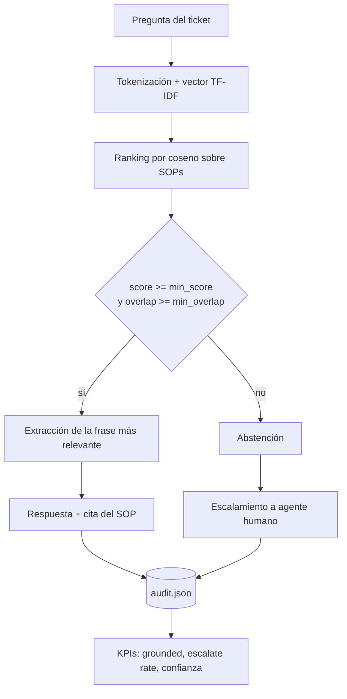
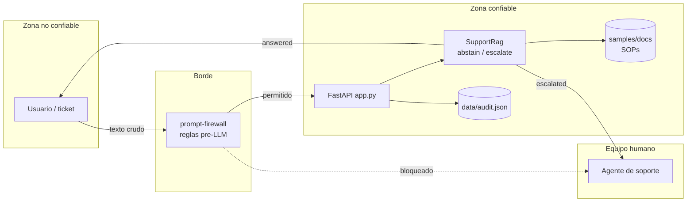

# Arquitectura

Autor: Angel Salazar Lima · CIP 404730

`support-copilot-lab` es un agente de soporte con RAG sobre SOPs locales. Su regla central: **responder solo con evidencia; si no la hay, abstenerse y escalar a un humano**.

## Flujo del agente



## Decisión abstain / escalate

La decisión vive en `SupportRag.ask` (`src/support_copilot/rag.py`) y combina dos señales:

| Señal | Qué mide | Umbral por defecto |
|-------|----------|--------------------|
| `score` | similitud coseno entre la pregunta y el mejor SOP | `0.12` |
| `overlap` | fracción de términos de contenido de la pregunta presentes en ese SOP | `0.34` |

Ambas deben cumplirse. Si falla cualquiera, el resultado es `status: escalated`, `escalated: true`, sin citas y con `reason`. El diseño prefiere un falso escalamiento (costo: un agente revisa) a una respuesta inventada (costo: error frente al cliente).

Estados posibles de una consulta:

| `status` | Significado |
|----------|-------------|
| `answered` | Respuesta extraída del SOP, con `citations` |
| `escalated` | Sin evidencia suficiente; derivada a humano |
| `blocked` | Rechazada por la capa de seguridad opcional (ver abajo); derivada a humano |

## Frontera de confianza

La pregunta del usuario es entrada no confiable. El corpus de SOPs es la única fuente que puede sustentar una respuesta. `prompt-firewall` se coloca **delante** del agente como filtro opcional.



## Integración con prompt-firewall

La integración es opcional y no agrega dependencia dura. El módulo `src/support_copilot/guard.py`:

1. Lee `SUPPORT_COPILOT_FIREWALL`. Con valor distinto de `1` (por defecto `0`) no hace nada.
2. Con `1`, intenta `from prompt_firewall.rules import inspect`. Si el paquete no está instalado, degrada sin error y el flujo sigue sin filtro.
3. Si `inspect` devuelve `allowed=False`, la consulta no llega a `SupportRag`: se registra con `status: blocked` y las reglas coincidentes en `reason`.

Para activarla:

```bash
pip install -e ../prompt-firewall
SUPPORT_COPILOT_FIREWALL=1 python -m support_copilot serve
```

Límite conocido: `prompt-firewall` detecta patrones en inglés (por ejemplo `ignore previous instructions`). No cubre variantes en español ni paráfrasis. Como el agente es extractivo y no ejecuta instrucciones del usuario, el riesgo residual es bajo, pero la capa no es una garantía.

## Componentes

| Módulo | Responsabilidad |
|--------|-----------------|
| `rag.py` | Índice TF-IDF, ranking, umbrales, extracción de respuesta |
| `guard.py` | Filtro opcional con prompt-firewall |
| `audit.py` | Registro JSON de cada consulta |
| `metrics.py` | KPIs a partir del registro |
| `experiment.py` | Evaluación contra `samples/asks.jsonl` |
| `app.py` | UI y endpoints `/ask`, `/clear`, `/api/stats`, `/health` |
| `cli.py` | Comandos `ask`, `experiment`, `serve` |

## Limitaciones

- Léxico puro: sin lematización, "pueden" no coincide con "puede".
- La respuesta es la frase con más términos coincidentes; puede elegir una frase del SOP correcto que no responde la pregunta.
- Se cita un único documento (el mejor).
- `audit.json` no es seguro ante concurrencia; es suficiente para un laboratorio local.
